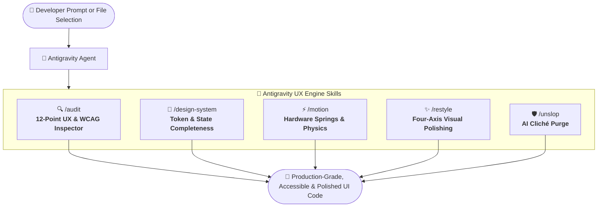

<div align="center">

# 🌌 Antigravity UX Engine Skills

<p align="center">
  <strong>Production-grade UI/UX engineering skills for Google Antigravity.</strong><br>
  Eliminate generic AI slop, enforce WCAG 2.1 AA accessibility, and inject deliberate design craftsmanship into frontend code.
</p>

<p align="center">
  <a href="./LICENSE"></a>
  <a href="https://antigravity.google"></a>
  <a href="https://github.com/agent-nau/Antigravity-UX-Engine-Skills"></a>
  <a href="https://www.w3.org/WAI/WCAG21/quickref/"></a>
  <a href="https://github.com/agent-nau/Antigravity-UX-Engine-Skills/stargazers"></a>
</p>

<p align="center">
  <a href="#-overview">Overview</a> •
  <a href="#-the-anti-slop-manifesto">The Manifesto</a> •
  <a href="#-architecture">Architecture</a> •
  <a href="#-the-5-core-skills">Skill Suite</a> •
  <a href="#-before--after-showcase">Before & After</a> •
  <a href="#-quickstart--installation">Installation</a> •
  <a href="#-usage-workflows">Usage</a> •
  <a href="#-license">License</a>
</p>

---

</div>

## 📖 Overview

Standard AI code generation frequently produces functional but visually uninspired "AI Slop":
* Muddy purple-to-blue linear gradients on every container
* Uniform `rounded-2xl` on inputs, buttons, and cards alike
* Low-contrast muted text that fails accessibility checks
* Missing interaction lifecycle states (`loading`, `empty`, `error`, `disabled`)
* Choppy, layout-thrashing animations (`transition: all 0.3s ease`)

**Antigravity UX Engine Skills** equips your Google Antigravity agents with production design-engineering guardrails. From generating components from scratch to refactoring legacy codebases, this skill suite transforms generic templates into bespoke, accessible, 60fps-smooth software.

---

## ⚡ The Anti-Slop Manifesto

| Design Vector | ❌ Generic AI Boilerplate | ✅ Antigravity UX Engine Standard |
| :--- | :--- | :--- |
| **Color & Surfaces** | Saturated neon radial gradients, arbitrary opacity overlays | Semantic token layers, distinct elevation surfaces, crisp 1px borders |
| **Border Radii** | Identical `rounded-2xl` or `rounded-full` everywhere | Calibrated scale (`4px` inputs, `6px` buttons, `10px` modal dialogs) |
| **Typography** | Low-contrast gray (`#9ca3af`) on dark backgrounds | WCAG 2.1 AA certified (≥ 4.5:1 ratio), optical tracking, clear weights |
| **Interaction States** | Static hover only; missing edge cases | Complete 5-state lifecycle: `default`, `hover`, `active`, `focus-visible`, `disabled` |
| **Animation Physics** | Layout reflows (`transition: all 0.3s ease`) | GPU transforms only (`translate3d`, `opacity`), cubic beziers, reduced-motion safe |
| **Accessibility** | Clickable `<div>` elements without labels or focus indicators | Semantic HTML5, explicit ARIA tags, visible keyboard focus rings |

---

## 🏗️ Architecture



---

## 🧰 The 5 Core Skills

### 1. 🔍 `/audit` — Heuristic & Accessibility Auditor
> **Run a comprehensive 12-point UX and accessibility heuristic audit on the specified code or component.**

Inspects components against core usability foundations:
* **Affordances & Feedback**: Interactive clarity, hover, active, and loading indicators under 100ms.
* **Accessibility (a11y)**: Semantic HTML tags, WCAG AA contrast (≥4.5:1), keyboard focus rings, and screen-reader ARIA roles.
* **State Completeness**: Graceful handling of `loading`, `empty`, `error`, and `success` views.
* **Content Hierarchy**: Mathematical weight distribution across primary, secondary, and tertiary elements.
* **Actionable Output**: Returns a severity score (`Critical` / `Warning` / `Improvement`), line coordinates, and drop-in code patches.

```bash
/audit inspect the checkout modal in src/components/CheckoutModal.tsx
```

---

### 2. 📐 `/design-system` — UI/UX Engineering Foundations
> **Core UI/UX engineering principles covering state completeness, accessibility, form UX, and design token enforcement.**

Enforces structural discipline during component authoring:
* **Intent Discovery**: Verifies user workflow goals before scaffolding markup.
* **Information Hierarchy**: Defines clear primary, secondary, and supporting visual anchors.
* **Form UX**: Inline validation, accessible labels (`<label htmlFor="...">`), contextual error text, and optimal input types.
* **Design System Enforcement**: Ingests `DESIGN.md` tokens for typography, spacing, and color palettes.
* **Responsive Guard**: Ensures fluid responsiveness across mobile (`<640px`), tablet, and desktop viewports.

```bash
/design-system scaffold a data-table component with sorting and multi-select
```

---

### 3. ⚡ `/motion` — Micro-Interactions & Animation Physics
> **Audit and generate deliberate UI micro-interactions, enter/exit transitions, and spring physics while respecting reduced motion settings.**

Injects fluid, hardware-accelerated animations into interactive components:
* **Timing & Curves**: Uses custom cubic beziers (e.g., `cubic-bezier(0.16, 1, 0.3, 1)`) instead of generic easings.
* **Sub-200ms Latency**: Keeps UI micro-interactions snappy and unobtrusive.
* **Zero Reflows**: Restricts animated properties strictly to `transform` and `opacity` to prevent costly browser repaints.
* **Accessibility**: Automatically wraps animations in `@media (prefers-reduced-motion: reduce)`.

```bash
/motion add enter/exit transitions and button press physics to the toast system
```

---

### 4. ✨ `/restyle` — Four-Axis Component Elevation
> **Eliminate generic AI visual tropes, apply DESIGN.md design tokens, and elevate component polishing.**

Performs a holistic 4-axis component polish:
* **Type**: Optical balance, weight pairing, line-height calibration.
* **Color**: Surface depth, tokenized light/dark palettes, WCAG AA contrast.
* **Space**: Spatial rhythm, uniform padding multipliers, density control.
* **Finish**: 1px micro-borders, subtle inner shadows, clear interaction rings.
* **Output**: Delivers production code alongside a clear "Before vs. After" structural breakdown.

```bash
/restyle redesign our navigation bar to match a clean developer-tool aesthetic
```

---

### 5. 🛡️ `/unslop` — AI Cliché Exorcism
> **Strip cliché AI aesthetic artifacts (purple glow, excessive rounded corners, low contrast) and replace with distinct brand styling.**

Directly targets and neutralizes common generative UI artifacts:
* **Purges Default Gradients**: Removes cliché violet-blue radial/linear overlays; replaces with clean solid surfaces.
* **Eliminates Glassmorphism Overuse**: Replaces muddy `backdrop-blur-md bg-white/10` with solid surfaces and crisp 1px borders.
* **Normalizes Radii**: Enforces purposeful corner radii (`4px` inputs, `6px` buttons, `10px` cards).
* **Fixes Muted Typography**: Elevates dim secondary text to meet or exceed the 4.5:1 WCAG contrast threshold.

```bash
/unslop remove AI clichés from this dashboard card component
```

---

## 🔬 Before & After Showcase

### ❌ Default AI Output (AI Slop)
```tsx
// Typical AI output: Muddy contrast, generic purple gradient, oversized radius, zero states
export function MetricCard({ title, value, change }) {
  return (
    <div className="bg-gradient-to-r from-purple-500 to-indigo-600 p-8 rounded-3xl shadow-2xl backdrop-blur-md">
      <p className="text-gray-300 text-sm">{title}</p>
      <h3 className="text-5xl font-extrabold text-white my-2">{value}</h3>
      <span className="text-xs text-gray-400 bg-white/10 px-3 py-1 rounded-full">
        {change}
      </span>
    </div>
  );
}
```

### ✅ Antigravity UX Engine Output
```tsx
// Token-driven, high contrast, WCAG AA certified, deliberate radii, complete state lifecycle
interface MetricCardProps {
  title: string;
  value: string | number;
  change: string;
  isPositive?: boolean;
  isLoading?: boolean;
}

export function MetricCard({
  title,
  value,
  change,
  isPositive = true,
  isLoading = false,
}: MetricCardProps) {
  if (isLoading) {
    return (
      <div 
        role="status"
        aria-label={`Loading ${title}`}
        className="h-32 w-full animate-pulse rounded-lg border border-neutral-200 bg-neutral-50 p-5 dark:border-neutral-800 dark:bg-neutral-900/50" 
      />
    );
  }

  return (
    <article className="group relative rounded-lg border border-neutral-200/80 bg-white p-5 shadow-xs transition-colors duration-150 hover:border-neutral-300 dark:border-neutral-800 dark:bg-neutral-900 dark:hover:border-neutral-700">
      <header className="flex items-center justify-between gap-2">
        <h3 className="text-xs font-medium tracking-wide uppercase text-neutral-500 dark:text-neutral-400">
          {title}
        </h3>
        <span
          className={`inline-flex items-center rounded-md px-2 py-0.5 text-xs font-semibold tabular-nums ${
            isPositive
              ? "bg-emerald-50 text-emerald-700 dark:bg-emerald-950/40 dark:text-emerald-400"
              : "bg-rose-50 text-rose-700 dark:bg-rose-950/40 dark:text-rose-400"
          }`}
        >
          {change}
        </span>
      </header>

      <p className="mt-3 text-2xl font-semibold tracking-tight text-neutral-950 dark:text-neutral-50">
        {value}
      </p>
    </article>
  );
}
```

---

## 🚀 Quickstart & Installation

### Option A: Install in a Specific Workspace (Recommended)

Place the skills directly into your repository's Antigravity skills directory:

```bash
# In your project root
mkdir -p .gemini/skills

# Clone the repository
git clone https://github.com/agent-nau/Antigravity-UX-Engine-Skills.git .gemini/skills/ux-engine
```

### Option B: Install Globally Across All Projects

Make the skills available everywhere on your machine:

#### macOS & Linux
```bash
git clone https://github.com/agent-nau/Antigravity-UX-Engine-Skills.git ~/.gemini/antigravity/skills/ux-engine
```

#### Windows (PowerShell)
```powershell
git clone https://github.com/agent-nau/Antigravity-UX-Engine-Skills.git "$HOME\.gemini\antigravity\skills\ux-engine"
```

---

## 💡 Usage Workflows

You can engage the skills using two seamless modalities:

### 1. Direct Slash Commands
In your Antigravity chat prompt, invoke the skill explicitly:
* `/audit` — Runs a 12-point UX and accessibility evaluation with patch suggestions.
* `/design-system` — Enforces tokens, responsive layouts, and state completeness.
* `/motion` — Computes cubic-bezier curves and injects GPU-safe CSS transitions.
* `/restyle` — Refactors visual density, type hierarchy, and micro-borders.
* `/unslop` — Strips cliché gradients, blur overlays, and low-contrast typography.

### 2. Autonomous Agent Detection
Antigravity automatically loads these skills when your request matches their capabilities:
* *"Check this button component for WCAG color contrast and keyboard navigation."*
* *"Refactor this card so it doesn't look like generic AI boilerplate."*
* *"Add subtle hover and click animations that respect reduced motion preferences."*

> [!TIP]
> **Supercharge with `DESIGN.md`:** Create a `DESIGN.md` file in your repository root specifying your brand colors, typography scales, and border-radius tokens. The skills will automatically read and enforce them.

---

## 📁 Repository Structure

```
Antigravity-UX-Engine-Skills/
├── audit/
│   └── SKILL.md          # 🔍 12-point UX & accessibility heuristic audit
├── design-system/
│   └── SKILL.md          # 📐 Core design foundations & token enforcement
├── motion/
│   └── SKILL.md          # ⚡ Micro-interactions, cubic beziers & reduced motion
├── restyle/
│   └── SKILL.md          # ✨ Anti-slop restyling & four-axis diagnosis
├── unslop/
│   └── SKILL.md          # 🛡️ AI cliché purger & contrast normalizer
├── .gitignore            # Clean git configuration
├── LICENSE               # MIT License
└── README.md             # Project documentation & usage guide
```

---

## 🤝 Contributing

Contributions from design engineers, accessibility specialists, and UI developers are welcome!

1. Fork the repository.
2. Create your branch (`git checkout -b feature/accessible-focus-rings`).
3. Commit your enhancements (`git commit -m "feat: enhance focus ring heuristics"`).
4. Push to your branch and submit a Pull Request.

---

## 📄 License

This project is open-source and licensed under the **[MIT License](./LICENSE)**.

```
MIT License

Copyright (c) 2026 agent-nau

Permission is hereby granted, free of charge, to any person obtaining a copy
of this software and associated documentation files (the "Software"), to deal
in the Software without restriction, including without limitation the rights
to use, copy, modify, merge, publish, distribute, sublicense, and/or sell
copies of the Software, and to permit persons to whom the Software is
furnished to do so, subject to the following conditions:

The above copyright notice and this permission notice shall be included in all
copies or substantial portions of the Software.
```

<div align="center">

---

<sub>Built with craft for the next generation of AI-assisted design engineering.</sub>

</div>
